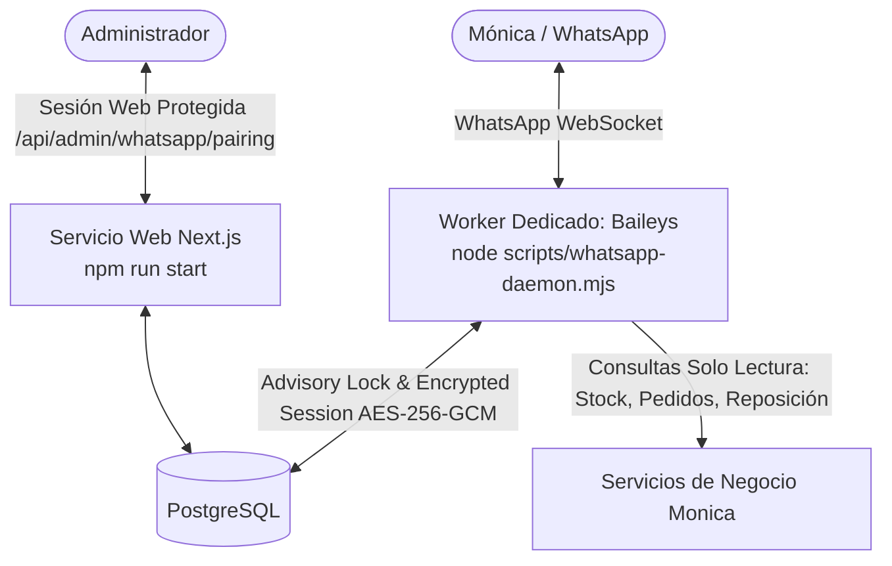

# Guía de Puesta en Marcha: Bot de WhatsApp con Baileys (Worker Dedicado)

Esta guía documenta la arquitectura, configuración, vinculación y despliegue del bot de WhatsApp para **La Casa del Kioskero** utilizando **Baileys** y persistencia autenticada en **PostgreSQL**.

---

## 1. Arquitectura del Sistema



- **Servicio Web Next.js:** Continúa funcionando de forma independiente sin alteraciones en su autenticación ni en su comando de inicio (`npm run start`).
- **Servicio Worker Dedicado:** Proceso independiente ejecutado mediante `node scripts/whatsapp-daemon.mjs`, con 1 sola réplica.
- **Persistencia en PostgreSQL (`whatsapp_baileys_session`):** Credenciales de WhatsApp y llaves Signal cifradas con AES-256-GCM authenticated encryption.
- **Candado de Asesoramiento (`pg_try_advisory_lock`):** Evita colisiones de sesión y desconexiones de WhatsApp (código de error 440) asegurando que solo un contenedor mantenga el socket activo.
- **Solo Lectura Estricto:** El bot no modifica pedidos, stock ni catálogos.

---

## 2. Variables de Entorno

En Railway, configurar las siguientes variables en el servicio **Worker** (y en el servicio Web para la ruta de administración):

| Variable | Requerida | Descripción | Ejemplo / Formato |
| :--- | :---: | :--- | :--- |
| `DATABASE_URL` | Sí | Cadena de conexión a PostgreSQL provista por Railway | `${{Postgres.DATABASE_URL}}` |
| `POSTGRES_SSL` | Sí | Habilita SSL para conexiones a PostgreSQL | `true` |
| `WHATSAPP_SESSION_ENCRYPTION_KEY` | Sí | Clave criptográfica independiente (mínimo 32 bytes) para cifrar la sesión | `d5e6f7a8b9c0...` (generar con `openssl rand -hex 32`) |
| `WHATSAPP_PAIRING_NUMBER` | Opcional | Número de teléfono de la línea del bot para solicitar código de vinculación de 8 dígitos | `5491112345678` |
| `WHATSAPP_ALLOWED_NUMBERS` | Sí | Lista de números autorizados separados por coma (formato E.164). Solo estos remitentes pueden realizar consultas de negocio. | `+5491112345678, +5491187654321` |
| `LOG_LEVEL` | Opcional | Nivel de detalle de logs en consola (`info`, `warn`, `error`) | `info` |

> [!IMPORTANT]
> **Seguridad de la Clave de Cifrado:**  
> La variable `WHATSAPP_SESSION_ENCRYPTION_KEY` nunca debe subirse al repositorio ni guardarse en la base de datos junto a los datos cifrados. Si se pierde esta clave, la sesión previa quedará inaccesible y será necesario revincular el bot.

---

## 3. Migración de Base de Datos

Las migraciones necesarias se encuentran en:
- `migrations/016_whatsapp_bot.sql`: Tablas `whatsapp_processed_messages` y `whatsapp_authorized_numbers`.
- `migrations/017_baileys_session.sql`: Tabla `whatsapp_baileys_session` con índice por `(session_id, key_id)`.

Las migraciones se ejecutan de manera estándar mediante:
```bash
npm run db:migrate
```

---

## 4. Despliegue en Railway (Segundo Servicio: Worker)

El repositorio soporta el servicio web existente y el nuevo servicio Worker en paralelo sobre el mismo proyecto y base de datos:

### Paso 1: Crear el servicio Worker en Railway
1. Ingresar al proyecto en [Railway Dashboard](https://railway.app/).
2. Hacer clic en **+ New** > **GitHub Repo**.
3. Seleccionar el repositorio `Joel010999/kioskeroappweb`.
4. Railway creará un segundo servicio en el mismo entorno.
5. Renombrar el nuevo servicio a **`whatsapp-worker`** en **Settings > General > Service Name**.

### Paso 2: Configurar el Comando de Inicio del Worker
1. En el servicio `whatsapp-worker`, ir a la pestaña **Settings > Deploy**.
2. Configurar:
   - **Build Command:** Dejar el predeterminado (`npm run build`).
   - **Start Command:** Ingresar exactamente:
     ```bash
     node scripts/whatsapp-daemon.mjs
     ```

### Paso 3: Configurar Réplicas (Single Replica)
1. En **Settings > Deploy > Replicas**, asegurarse de que las réplicas estén configuradas en **1**.
2. **Prevención de Conexiones Duplicadas:**  
   El Worker adquiere automáticamente el advisory lock `7429103` en PostgreSQL. Si durante un redespliegue conviven brevemente dos contenedores, el nuevo contenedor detectará que el candado está ocupado y mostrará en sus logs:
   ```json
   {"level":40,"msg":"Advisory lock 7429103 is currently held by another worker instance. Standing by (retry in 5s)..."}
   ```
   No se conectará a WhatsApp hasta que la instancia anterior termine y libere el candado.

### Paso 4: Copiar Variables de Entorno
1. En la pestaña **Variables** de `whatsapp-worker`, agregar:
   - `DATABASE_URL = ${{Postgres.DATABASE_URL}}`
   - `POSTGRES_SSL = true`
   - `WHATSAPP_SESSION_ENCRYPTION_KEY = <clave_secreta_generada>`
   - `WHATSAPP_PAIRING_NUMBER = <numero_del_bot>`
   - `WHATSAPP_ALLOWED_NUMBERS = <numeros_autorizados>`
   - `LOG_LEVEL = info`

---

## 5. Procedimiento de Vinculación de Dispositivo

Para vincular la cuenta de WhatsApp por primera vez sin exponer códigos en logs públicos ni crear endpoints vulnerables, se proporcionan dos mecanismos:

### Opción A: Vinculación Local Protegida (Recomendada)
1. En una terminal local conectada a la base de datos o mediante `railway run`:
   ```bash
   node scripts/whatsapp-pair.mjs 5491112345678
   ```
2. El script se conectará de manera interactiva y mostrará en la consola del operador:
   ```
   ==================================================
   >>> CÓDIGO DE VINCULACIÓN: ABCD-1234 <<<
   ==================================================
   ```
3. En el teléfono del bot, abrir WhatsApp > **Dispositivos Vinculados** > **Vincular un dispositivo** > **Vincular con el número de teléfono**.
4. Ingresar el código de 8 dígitos.
5. La sesión se cifrará con AES-256-GCM y se guardará automáticamente en PostgreSQL en la tabla `whatsapp_baileys_session`.
6. El script finalizará exitosamente. El Worker en Railway ya puede iniciarse y usará esa sesión.

### Opción B: Endpoint Administrativo Protegido
1. Si el Worker está corriendo sin sesión previa, genera el código y lo guarda temporalmente cifrado en la base de datos (con TTL de 150 segundos).
2. Un operador con sesión iniciada en la web de Mónica puede consultar:
   ```
   GET /api/admin/whatsapp/pairing
   ```
   - Si no está autenticado, la API responde `401 Unauthorized`.
   - Si está autenticado, devuelve `{ status: "pending", code: "ABCD-1234", expiresAt: ... }`.
3. Una vez vinculado el teléfono, el código se destruye inmediatamente.

---

## 6. Recuperación de Sesión y Manejo de Fallas

- **Reinicio del Contenedor:** Al iniciar, el Worker lee las credenciales descifrándolas desde PostgreSQL y reconecta la sesión sin requerir nuevo código.
- **Caída de Red / Desconexión Temporal:** Si WhatsApp desconecta el socket, el Worker reintenta con backoff exponencial manteniendo el candado.
- **Pérdida de Conexión con PostgreSQL:** Si la conexión dedicada del advisory lock se interrumpe, el Worker cierra inmediatamente el socket de WhatsApp para evitar conflictos y no reconecta hasta revalidar el candado.
- **Cierre de Sesión Remoto (`loggedOut`):** Si el usuario desvincula el bot desde la app móvil de WhatsApp, el Worker limpia automáticamente los registros en `whatsapp_baileys_session` y queda a la espera de una nueva vinculación.
- **Cierre Ordenado (`SIGTERM` / `SIGINT`):** Al recibir la señal de apagado de Railway, el daemon cierra el socket de WhatsApp, libera el advisory lock en PostgreSQL y finaliza con código 0.

---

## 7. Consultas Disponibles para Mónica

El bot mantiene el 100% de las consultas de solo lectura existentes:
1. **Stock por Producto:** `"Stock alfajores Jorgito"` o `"Stock galletitas en jardín"`.
2. **Alertas de Faltantes:** `"Alertas de stock"` o `"Faltantes centro"`.
3. **Reposición Semanal:** `"Sugerencia de reposición"` o `"Reposición"`.
4. **Detalle de Pedido:** `"Pedido 1050"` o `"Estado pedido 1024"`.
5. **Pedidos Pendientes:** `"Pedidos pendientes"` o `"Pendientes de entrega"`.
6. **Pedidos Recientes:** `"Últimos pedidos"` o `"Pedidos jardín"`.
7. **Proveedores de Producto:** `"Quién provee coca cola"` o `"Proveedor alfajor havanna"`.
8. **Productos de Proveedor:** `"Productos de Arcor"` o `"Qué le compramos a Mondelez"`.
9. **Métricas de Período:** `"Ventas de este mes"`, `"Resumen mes pasado"`, `"Métricas"`.
10. **Productos Más Vendidos:** `"Top productos"` o `"Más vendidos este mes"`.
11. **Estado del Sistema:** `"Estado del sistema"` o `"Salud del sistema"`.
12. **Ayuda y Menú:** `"Hola"`, `"Menú"` o `"Ayuda"`.
